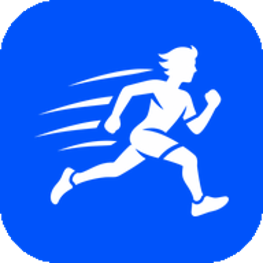
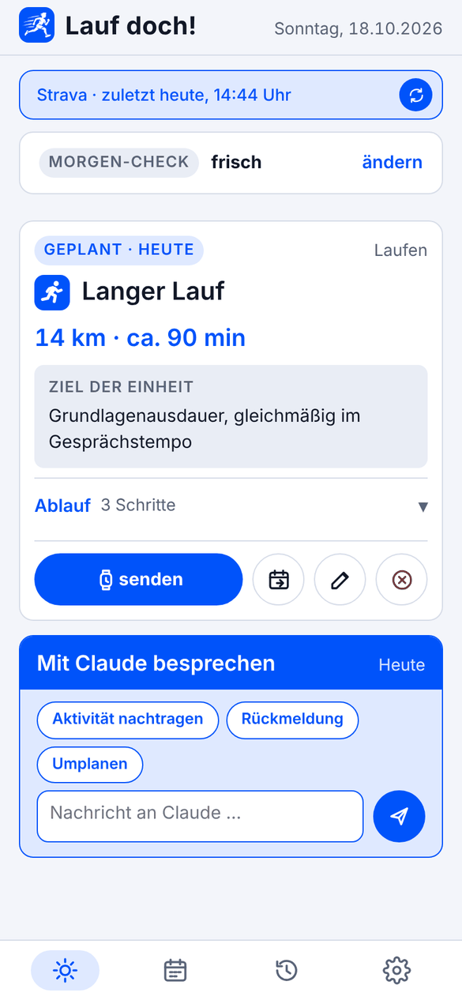
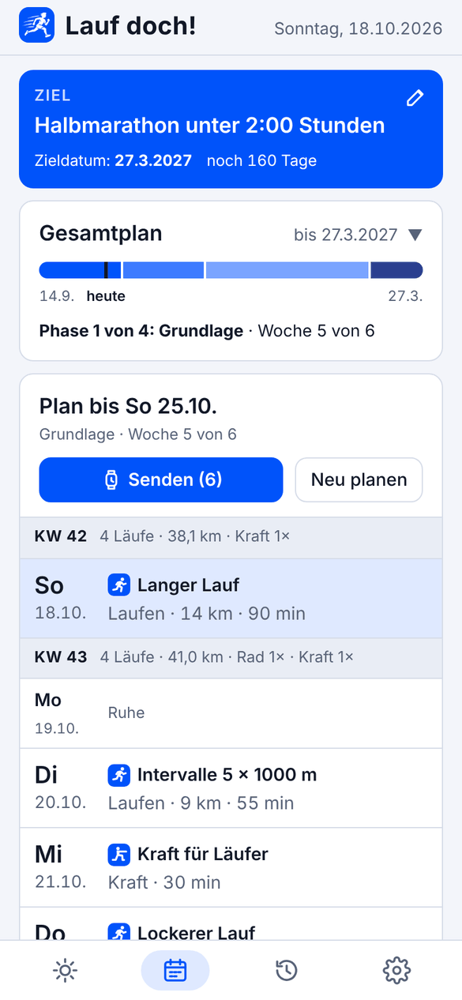
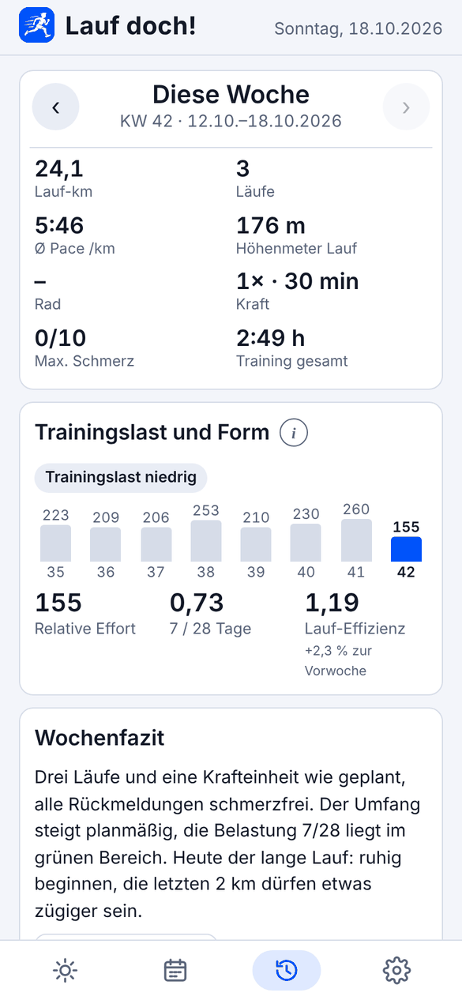
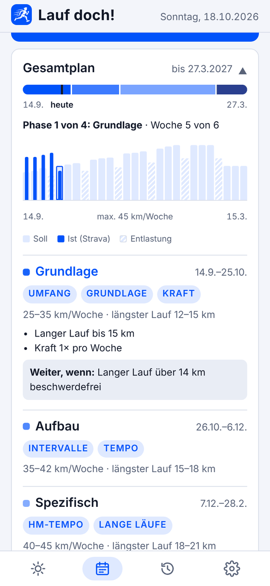
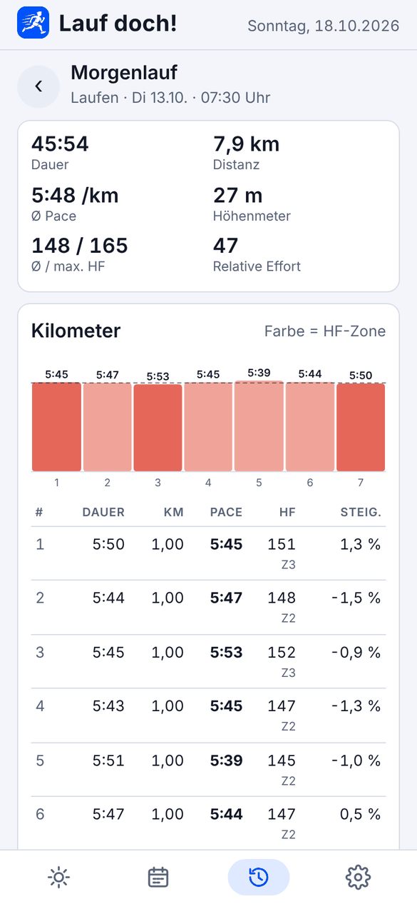
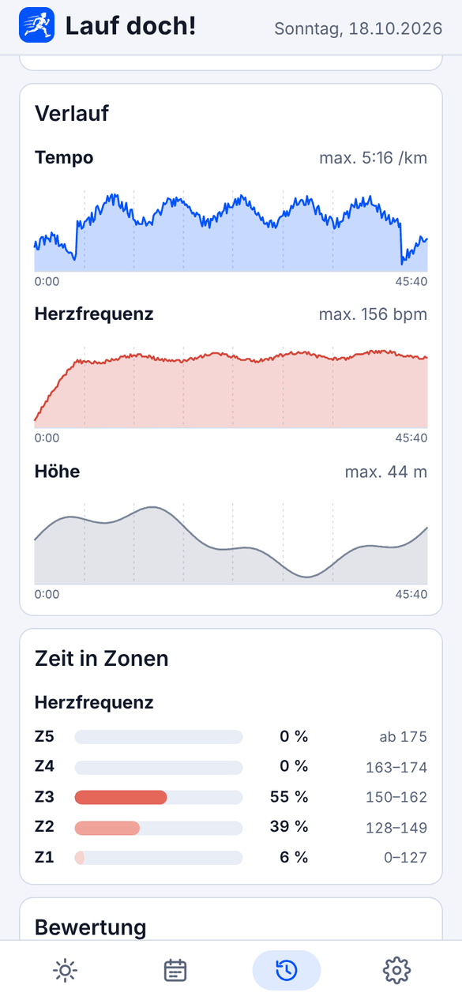

  

<h1 align="center">Lauf doch!</h1>

<b>Adaptives Lauftraining mit Claude als Trainingsbegleiter</b> 
Strava rein, Plan raus – und der Plan passt sich an dich an.

  
  
  
  
  

  <a href="https://github.com/swissalpine/lauf-doch/releases/latest"><b>APK herunterladen</b></a> ·
  <a href="https://swissalpine.github.io/lauf-doch/web/"><b>Web-App öffnen</b></a> ·
  <a href="#einrichtung"><b>Einrichtung</b></a>

  &nbsp;
  &nbsp;
  

**Lauf doch!** ist eine App für adaptives Lauftraining mit Claude als Trainingsbegleiter – als **Android-App** und als **Web-App** für iPhone, iPad und Computer. Die App holt deine Aktivitäten aus Strava, wertet sie aus und lässt Claude daraus einen Trainingsplan erstellen. Diesen Plan passt Claude laufend an deine Rückmeldungen, deine Belastung und eventuelle Beschwerden an. Rad, Kraft und Mobilität werden ergänzend geplant. Geplante Einheiten können über intervals.icu auf eine Garmin-Uhr übertragen werden.

> Die App ersetzt keine ärztliche oder physiotherapeutische Beratung. Bei neuen, anhaltenden oder zunehmenden Schmerzen bitte abklären lassen.

---

## Inhalt

- [Funktionen im Überblick](#funktionen-im-überblick)
- [So entsteht ein Plan](#so-entsteht-ein-plan)
- [Daten und Datenschutz](#daten-und-datenschutz)
- [Einrichtung](#einrichtung)
  - [1. App installieren](#1-app-installieren)
    - [Android](#android)
    - [iPhone, iPad und Computer (Web-App)](#iphone-ipad-und-computer-web-app)
  - [2. Claude (Anthropic API)](#2-claude-anthropic-api)
  - [3. Strava](#3-strava)
  - [4. Garmin über intervals.icu (optional)](#4-garmin-über-intervalsicu-optional)
  - [5. Erinnerungen (optional)](#5-erinnerungen-optional)
  - [6. Profil ausfüllen und ersten Plan erstellen](#6-profil-ausfüllen-und-ersten-plan-erstellen)
- [Datensicherung](#datensicherung)
- [Android-App und Web-App im Vergleich](#android-app-und-web-app-im-vergleich)
- [Aufbau des Projekts](#aufbau-des-projekts)
- [Grenzen](#grenzen)

---

## Funktionen im Überblick

Die App hat vier Bereiche. Die Bilder zeigen Beispieldaten. Auf jeder Seite gibt es unten den Dialog mit Claude, mit Themenvorschlägen passend zur Seite.

### Heute
- **Strava-Abgleich:** Beim Öffnen automatisch, wenn der letzte Abgleich länger als 15 Minuten zurückliegt, sonst per Knopf. Für neue Läufe und Radfahrten holt die App auch die Verlaufsdaten (Puls, Tempo, Leistung, Höhe).
- **Morgen-Check:** Am Tag nach einer Einheit fragt die App kurz nach dem Zustand. Bei eingetragenen Beschwerden ist das der Schmerz von 0 bis 10, sonst das Befinden (frisch, normal, müde, Muskelkater, Schmerzen).
- **Einheit des Tages:** Ziel, Ablauf Schritt für Schritt mit Zielwerten (RPE, HF-Zone, Pace, Watt), dazu Verschieben, Umplanen und Absagen.
- **Absolvierte Einheit:** Kennzahlen, Leistungsauswertung, RPE und Schmerz (während und danach) zum Antippen sowie die Einschätzung von Claude. Die Analyseseite zeigt Runden, Verlaufskurven und die Zeit in den Zonen.
- **Trainingsmodus für Kraft und Mobilität:** Führt Satz für Satz durch die Übungen, mit Countdown für Halteübungen, Wiederholungszähler, automatischer Satzpause (Ton und Vibration), Schmerzabfrage je Übung und Pause-Funktion. Das Protokoll wird gespeichert und kann an Strava gesendet werden. Alternativ lässt sich eine Einheit auch einfach als erledigt markieren.

### Plan
- **Gesamtplan:** Phasen vom Start bis zum Ziel mit Wochenumfang, längstem Lauf, Schwerpunkten und Kriterien für den Übergang zur nächsten Phase. Gibt es kein festes Zieldatum, schätzt Claude ein realistisches Enddatum.
- **Detailplan** für die laufende und die nächste Woche:
  - Blau: geplant
  - Grün: geplant und erledigt, mit den tatsächlichen Werten
  - Orange: zusätzliche, nicht geplante Aktivität
- **Senden an die Uhr** (mit intervals.icu) und **Neu planen**.

  

### Rückblick
- Wochenwerte: Lauf-km, Läufe, Pace, Höhenmeter, Rad, Kraft, maximaler Schmerz, Trainingszeit gesamt.
- **Trainingslast und Form:** Relative Effort der letzten 8 Wochen, Verhältnis der Belastung 7 zu 28 Tagen, Lauf-Effizienz im Vergleich zur Vorwoche.
- **Schmerz und Belastung:** Lauf-km und höchster Schmerzwert je Woche. Die Karte erscheint nur, wenn Schmerz gemeldet wurde.
- **Wochenfazit** von Claude und alle Einheiten der Woche, jeweils mit Analyse.

  &nbsp;
  

### Einstellungen
- **Profil:** Name, Sportarten, Leistungsstand, Trainingstage.
- **Abwesenheiten:** Urlaub oder Reisen, entweder „kein Training“ oder „eingeschränkt“ mit Notiz.
- **Fitness und Beschwerden:** Sind Beschwerden eingetragen, plant Claude vorsichtiger und fragt gezielt nach Schmerz.
- **Was Claude weiß:** Erkenntnisse, Hintergrund und Dialogverlauf ansehen und bearbeiten.
- **Erinnerungen**, **Verbindungen** (Claude, Strava, Garmin, mit Verbrauchsanzeige für Claude) und **Datensicherung**.

---

## So entsteht ein Plan

Claude bekommt bei jeder Anfrage einen festen Regelteil und den aktuellen Stand deiner Daten. Daraus erstellt Claude Antwort und Planänderungen. Die App prüft die Änderungen und übernimmt sie.

**Was Claude bekommt**

| Bereich | Inhalt |
|---|---|
| Profil | Ziel und Zieldatum, Leistungsstand, Trainingstage, Sportarten, Beschwerden, Abwesenheiten, Hintergrund, gespeicherte Erkenntnisse |
| Aktivitäten | Strava-Aktivitäten der letzten 6 Wochen mit Pace, HF, Zonen, Effizienz, Entkopplung (nur im Hauptteil ohne Ein- und Auslaufen), Watt und %FTP, Runden der Uhr |
| Rückmeldungen | Schmerz während und danach, RPE, Morgen-Checks, Krafttraining-Protokolle |
| Belastung | Wochenwerte, Relative Effort, Verhältnis der Belastung 7 zu 28 Tagen, Wochenfazits |
| Plan | aktueller Detailplan, Gesamtplan mit Phasen und Wochen-Soll, Kalender mit Trainingstagen |

**Regeln, nach denen Claude plant**
- Geplant wird immer von heute bis Sonntag der nächsten Woche, nur an Trainingstagen und nicht an Tagen mit Abwesenheit „kein Training“. Zu Wochenbeginn verlängert die App den Plan automatisch.
- Der Detailplan leitet sich aus der aktuellen Phase und dem Wochen-Soll des Gesamtplans ab. Den Gesamtplan passt Claude nur bei klarem Anlass an: geändertes Ziel, geänderte Trainingstage oder Abwesenheiten, eine Woche mit deutlich weniger als 70 % des Solls, wiederholte Beschwerdesignale oder vorzeitig erfüllte Übergangskriterien.
- Bei eingetragenen Beschwerden gilt Schmerz bis 2/10 während der Belastung als akzeptabel, wenn er am Folgetag abgeklungen ist. Darüber wird nicht gesteigert, sondern reduziert oder auf schonendere Belastung umgestellt.
- Kraft, Mobilität und Dehnen sind immer eigene Einheiten mit Übungen, Sätzen, Wiederholungen oder Haltezeit und Pause.
- Wattbereiche sind eng (etwa ±5 % um den Zielwert) und beginnen nie bei 0, damit auch eine Rolle im ERG-Modus sinnvolle Werte bekommt.

**Woher das Fachwissen kommt**
Claude plant mit allgemeinem sportwissenschaftlichem Wissen aus dem eigenen Training des Modells, z. B. zu Periodisierung, Grundlagen- und Intensitätsverteilung, Belastungssteuerung über HF, RPE und Leistung sowie Kraft- und Reha-Übungen. Während der Planung wird nichts live nachgeschlagen. Das Ergebnis ist eine plausible, an die eigenen Daten angepasste Ableitung, kein geprüftes medizinisches Protokoll. Vorgaben von Physiotherapie oder Arzt trägt man am besten unter **Hintergrund** oder **Erkenntnisse** ein, dann richtet sich Claude danach.

**Wann Claude von sich aus tätig wird**
- Neue Aktivitäten nach dem Strava-Abgleich werden eingeschätzt, danach fragt Claude nach der Anstrengung (RPE) und – bei eingetragenen Beschwerden – nach Schmerz.
- Ausgelassene Einheiten der letzten Tage werden neu verteilt, gekürzt oder gestrichen.
- Nach Änderungen in den Einstellungen wird neu geplant, sobald man die Einstellungen verlässt.

---

## Daten und Datenschutz

- Alle Trainingsdaten (Profil, Plan, Aktivitäten, Rückmeldungen, Dialog) liegen **nur auf dem eigenen Gerät**. Es gibt keinen eigenen Server; auch die Web-App ist nur eine Seite, die im Browser läuft.
- API-Schlüssel und Strava-Zugangsdaten liegen in der Android-App in deren Einstellungen, in der Web-App im Speicher des Browsers.
- An **Anthropic** geht bei jeder Claude-Anfrage der oben beschriebene Kontext. An **Strava** gehen nur Abrufe und, wenn eingeschaltet, selbst angelegte Krafteinheiten. An **intervals.icu** gehen nur die geplanten Lauf- und Radeinheiten.

---

## Einrichtung

### 1. App installieren

#### Android

1. Unter [Releases](https://github.com/swissalpine/lauf-doch/releases) die neueste `LaufDoch.apk` herunterladen.
2. Auf dem Handy öffnen. Android fragt beim ersten Mal, ob die Installation aus dieser Quelle erlaubt werden soll.
3. Voraussetzung ist Android 10 oder neuer.

**Updates:** Die App prüft einmal am Tag, ob es eine neue Version gibt, und bietet sie zum Installieren an (auch unter Einstellungen → Über Lauf doch! → „Nach Updates suchen“). Android fragt dabei einmalig, ob die App Updates installieren darf. Die Daten bleiben erhalten.

#### iPhone, iPad und Computer (Web-App)

Die Web-App ist dieselbe Oberfläche wie die Android-App und läuft direkt im Browser. Es muss nichts gebaut oder installiert werden.

**iPhone und iPad**
1. In **Safari** die Adresse **[swissalpine.github.io/lauf-doch/web/](https://swissalpine.github.io/lauf-doch/web/)** öffnen.
2. Unten auf **Teilen** (Quadrat mit Pfeil) tippen → **Zum Home-Bildschirm** → **Hinzufügen**.
3. Lauf doch! ab jetzt über das neue Symbol auf dem Home-Bildschirm öffnen – nicht über einen Safari-Tab. Die App läuft dann im Vollbild und behält ihre Daten getrennt von Safari.

**Computer** (Chrome, Edge, Safari, Firefox): Die Adresse oben öffnen. In Chrome und Edge lässt sich die Seite über das Installieren-Symbol in der Adressleiste auch als eigenes Fenster anlegen.

**Updates:** Die Web-App ist immer aktuell; neue Versionen erscheinen beim nächsten Öffnen bzw. Neuladen.

**Daten übernehmen:** Wer schon die Android-App nutzt, legt dort eine Sicherung an und lädt die Datei in der Web-App unter Einstellungen → Datensicherung → „Sicherung laden“. Beide Versionen haben danach getrennte Datenstände.

### 2. Claude (Anthropic API)

Die App spricht Claude direkt über die Anthropic API an. Abgerechnet wird nach Verbrauch über das eigene Anthropic-Konto, unabhängig von einem claude.ai-Abo.

1. Unter [console.anthropic.com](https://console.anthropic.com) anmelden oder ein Konto anlegen.
2. Unter **Billing** Guthaben aufladen. Ohne Guthaben antwortet die API nicht.
3. Unter **API Keys** einen neuen Schlüssel anlegen und kopieren. Er beginnt mit `sk-ant-` und wird nur einmal angezeigt.
4. In der App: **Einstellungen → Verbindungen → Claude** den Schlüssel eintragen, ein Modell wählen und **Speichern** tippen.

**Modelle**
- **Sonnet:** empfohlen, gutes Verhältnis von Qualität und Kosten.
- **Opus:** gründlicher, aber teurer.
- **Haiku:** schnell und günstig, bei komplexen Planungen weniger sorgfältig.

**Kosten:** Unter Verbindungen → Claude zeigt die App Anfragen und geschätzte Kosten für den laufenden Monat und den Vormonat. Die Schätzung beruht auf Listenpreisen; die genaue Abrechnung steht in der Anthropic Console. Der feste Regelteil wird zwischengespeichert (Prompt-Caching), das senkt die Kosten wiederholter Anfragen deutlich.

### 3. Strava

Strava erlaubt den Datenzugriff nur über eine eigene API-Anwendung. Diese legt man einmalig selbst an.

1. Unter [strava.com/settings/api](https://www.strava.com/settings/api) eine Anwendung anlegen:
   - **Anwendungsname:** beliebig, z. B. „Lauf doch“
   - **Kategorie:** z. B. „Training“
   - **Website:** beliebig, z. B. `https://swissalpine.github.io/lauf-doch`
   - **Autorisierungs-Callback-Domain:** `swissalpine.github.io` (genau so, sonst klappt die Anmeldung nicht)
2. Nach dem Speichern zeigt Strava **Client-ID** und **Client-Secret**.
3. In der App: **Einstellungen → Verbindungen → Strava** beide Werte eintragen und **Mit Strava verbinden** tippen.
4. Bei Strava anmelden und zustimmen. Strava leitet danach zurück in die App bzw. die Web-App, die Verbindung ist eingerichtet.

Die Callback-Domain ist für Android-App und Web-App dieselbe; eine Strava-Anwendung reicht also auch, wenn man beide Versionen nutzt.

**Krafteinheiten an Strava senden (optional)**
Unter Verbindungen → Strava gibt es den Schalter **„Kraft an Strava senden“**. Ist er an, legt die App für erledigte oder aufgezeichnete Krafteinheiten eine manuelle Strava-Aktivität an. Sie enthält Dauer, Startzeit und die Übungen als Beschreibung. Beim nächsten Abgleich ersetzt diese Strava-Aktivität den Eintrag in der App.
- Dafür braucht die App die Schreibberechtigung. Nach dem Einschalten einmal **„Strava neu verbinden“** tippen und zustimmen.
- Die Strava-Schnittstelle erlaubt kein Löschen. Wird eine Einheit in der App rückgängig gemacht, muss sie in Strava selbst gelöscht werden.
- Wer Kraft schon mit der Uhr aufzeichnet, lässt den Schalter aus, sonst steht die Einheit doppelt in Strava.

### 4. Garmin über intervals.icu (optional)

Geplante Lauf- und Radeinheiten lassen sich als strukturierte Workouts auf eine Garmin-Uhr übertragen. Den Weg dorthin übernimmt [intervals.icu](https://intervals.icu).

1. Ein Konto bei intervals.icu anlegen und unter **Einstellungen → Verbindungen** mit Garmin Connect verbinden.
2. In der Garmin-Verbindung **„Upload planned workouts“** bzw. das Hochladen geplanter Trainings aktivieren.
3. In intervals.icu unter **Einstellungen → Entwickler** (Developer Settings) einen **API-Schlüssel** erzeugen.
4. In der App: **Einstellungen → Verbindungen → Garmin** den Schlüssel eintragen und die Zielvorgabe wählen.

| Sportart | Zielvorgaben |
|---|---|
| Laufen | Herzfrequenz-Zone, Pace (nur flach sinnvoll), RPE als Text |
| Rad | Herzfrequenz-Zone, Watt-Bereich (% FTP), Wattzahl für ERG-Modus (fester Wert, z. B. für Tacx), RPE als Text |

**Gut zu wissen**
- Senden: Im Plan einzeln oder alles auf einmal. Mit „automatisch senden“ werden Änderungen selbstständig übertragen.
- Verschobene oder gestrichene Einheiten löscht die App auch bei intervals.icu.
- intervals.icu überträgt jeweils die **nächsten 7 Tage** an Garmin. Was weiter in der Zukunft liegt, kommt automatisch nach.
- Kraft und Mobilität bleiben in der App und gehen nicht an die Uhr.
- Für Watt-Vorgaben muss in Strava eine FTP hinterlegt sein.

### 5. Erinnerungen (optional, nur Android)

Unter **Einstellungen → Erinnerungen** lassen sich zwei Benachrichtigungen einschalten:
- **Morgens** (Standard 7:00): Einheit des Tages und Morgen-Check.
- **Abends** (Standard 20:00): nur wenn heute eine Einheit geplant war und die Rückmeldung noch fehlt.

Beim ersten Einschalten fragt Android nach der Erlaubnis für Benachrichtigungen. Die Texte stammen vom Stand beim letzten Öffnen der App.

### 6. Profil ausfüllen und ersten Plan erstellen

1. **Einstellungen → Profil:** Name, Sportarten, Leistungsstand (z. B. „10 km in 52 min“) und Trainingstage eintragen.
2. Bei Bedarf **Beschwerden** und **Abwesenheiten** ergänzen.
3. Auf **Heute** oder **Plan** im Dialog das Ziel nennen, z. B. „Halbmarathon im Frühjahr, schmerzfrei“, und um einen Plan bitten.
4. Claude legt Ziel, Gesamtplan und den Plan bis Ende nächster Woche an.

Danach läuft alles weitgehend von selbst: trainieren, Strava abgleichen, Rückmeldungen (RPE, bei Beschwerden auch Schmerz) in der Karte antippen.

---

## Datensicherung

Unter **Einstellungen → Datensicherung**:
- **Sicherung speichern** legt eine Datei `lauf-doch-sicherung-JJJJ-MM-TT.json` ab – unter Android im Ordner „Downloads“, in der Web-App als Download (auf dem iPhone in der App „Dateien“).
- **Sicherung laden** liest eine solche Datei ein und **ersetzt** alle Daten auf dem Gerät.

In der Web-App sind regelmäßige Sicherungen besonders wichtig: Die Daten liegen im Speicher des Browsers, und den kann das System bei Platzmangel oder beim Löschen der Website-Daten leeren.

Mit dem Häkchen „Zugangsdaten mitsichern“ kommen auch Claude-Schlüssel, Strava Client-ID/Secret und intervals.icu-Schlüssel in die Datei – so lassen sie sich z. B. von der Android-App in die Web-App übertragen. Eine solche Datei nicht weitergeben. Die Strava-Verbindung selbst wird nie gesichert: Auf dem neuen Gerät einmal „Mit Strava verbinden“ tippen.

---

## Android-App und Web-App im Vergleich

| Funktion | Android-App | Web-App (iPhone/iPad) | Web-App (Computer) |
|---|---|---|---|
| Planen, Auswerten, Dialog mit Claude | ✓ | ✓ | ✓ |
| Strava, Garmin über intervals.icu, Kraft an Strava | ✓ | ✓ | ✓ |
| Trainingsmodus für Kraft | ✓ | ✓ | ✓ |
| Bildschirm bleibt im Training an | ✓ | ab iOS 18.4 | je nach Browser |
| Ton am Ende von Haltezeit und Pause | ✓ | ✓ (bei eingeschaltetem Bildschirm) | ✓ |
| Vibration | ✓ | – (von iOS nicht unterstützt) | – |
| Erinnerungen morgens/abends | ✓ | – | – |
| Updates | in der App angeboten | automatisch | automatisch |
| Speicherort der Daten | App-Speicher | Browser-Speicher | Browser-Speicher |

Für die Web-App gibt es keine lokal geplanten Benachrichtigungen, weil iOS Web-Apps nur Push-Nachrichten von einem Server erlaubt – und Lauf doch! bewusst ohne Server auskommt.

---

## Aufbau des Projekts

Die Oberfläche ist eine Web-App. In der Android-App läuft sie in einer WebView, die über `window.Android` die Verbindungen bereitstellt. In der Web-App übernimmt `web/android-web.js` diese Rolle und ruft Claude, Strava und intervals.icu direkt aus dem Browser auf.

| Datei | Aufgabe |
|---|---|
| `app/src/main/assets/index.html` | Oberfläche, Auswertung, Planungslogik und Prompts für Claude |
| `app/src/main/assets/shim.js` | Brücke zwischen Oberfläche und App: Speicher (localStorage), Strava-Abrufe, Claude-Anfragen mit Prompt-Caching, Verbrauchszählung |
| `app/src/main/java/de/laufdoch/MainActivity.java` | WebView, Strava-OAuth, HTTP-Aufrufe an Anthropic, Strava und intervals.icu, Datensicherung, Berechtigungen |
| `app/src/main/java/de/laufdoch/ReminderReceiver.java` | Erinnerungen per AlarmManager, auch nach Neustart |
| `app/src/main/java/de/laufdoch/UpdateReceiver.java` | Rückmeldung des Paketinstallers beim App-Update |
| `web/index.html` | Einstieg der Web-App: lädt dieselbe Oberfläche wie die Android-App |
| `web/android-web.js` | Ersatz der Android-Brücke im Browser: Claude, Strava (inkl. Anmeldung), intervals.icu, Datensicherung, Bildschirmsperre |
| `web/manifest.webmanifest`, `web/icon-*.png` | Name und Symbol für „Zum Home-Bildschirm“ |
| `docs/` | Logo und Screenshots für diese Seite (mit Beispieldaten) |

---

## Grenzen

- **Keine Diagnose:** Die App ersetzt keine medizinische Beurteilung. Die Schmerzregeln sind bewusst vorsichtig, aber allgemein.
- **Abhängig von Strava:** Ohne Strava-Abgleich fehlen Auswertung und Anpassung. Die Abrufe der App liegen weit unter den Limits der Strava-API.
- **Erinnerungen ohne Hintergrundabgleich (Android):** Was nach dem letzten Öffnen in Strava dazukommt, kennt die Abenderinnerung noch nicht.
- **Web-App:** keine Erinnerungen, keine Vibration auf dem iPhone, Daten nur im Browser des jeweiligen Geräts. Kein Zugriff auf Apple Health oder die Apple Watch.
